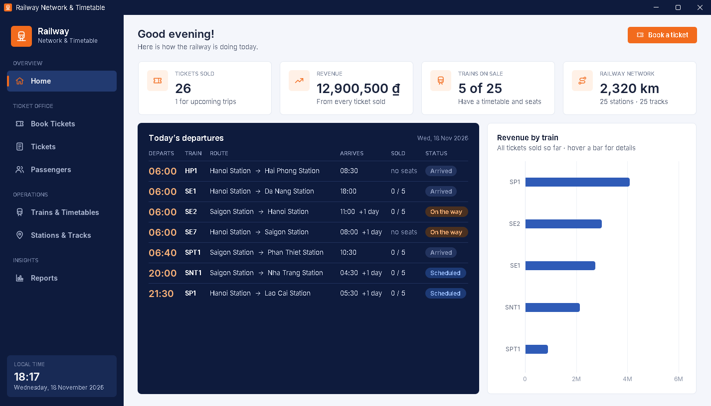
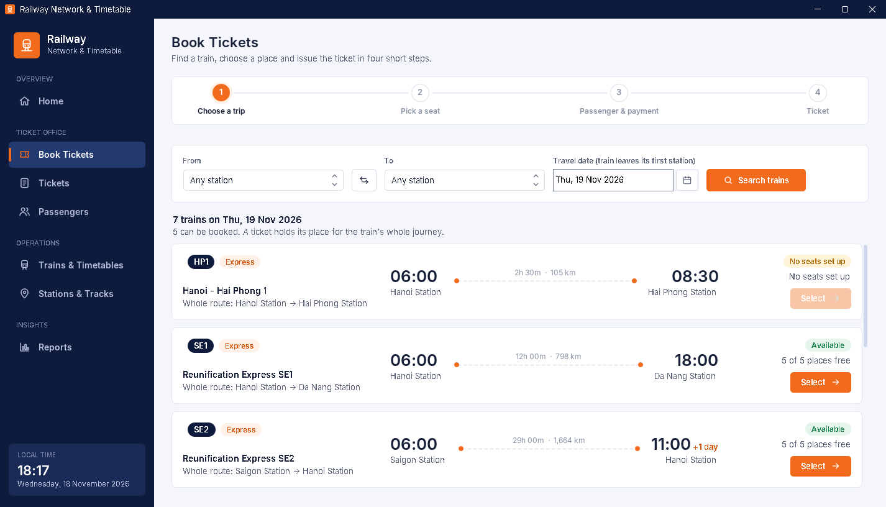
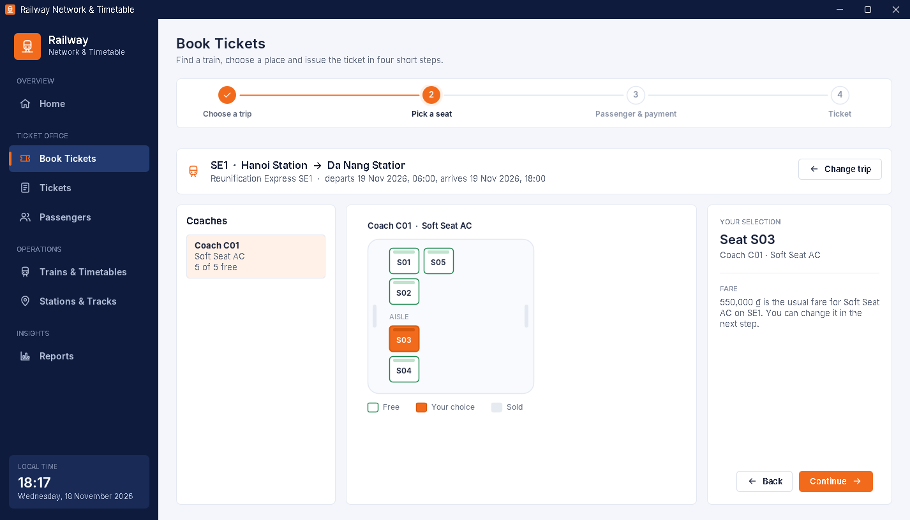
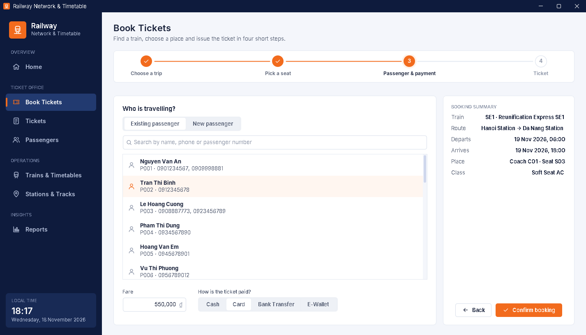
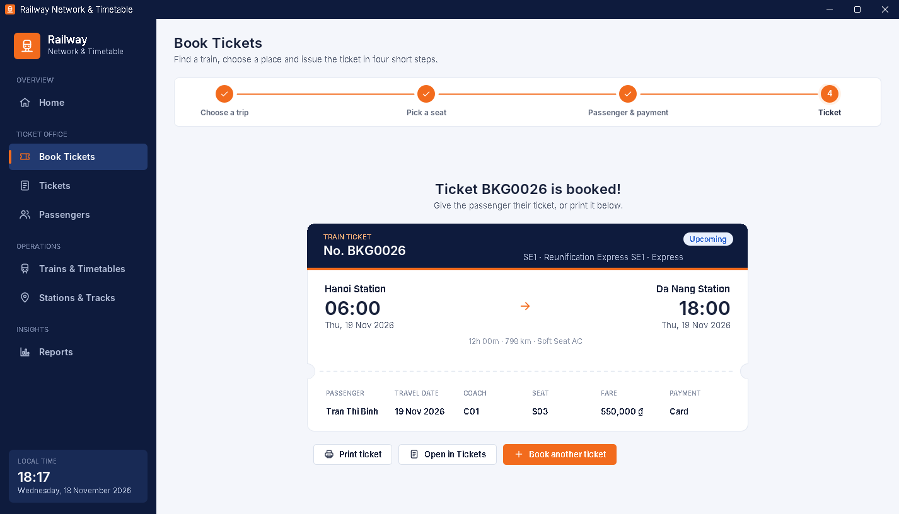
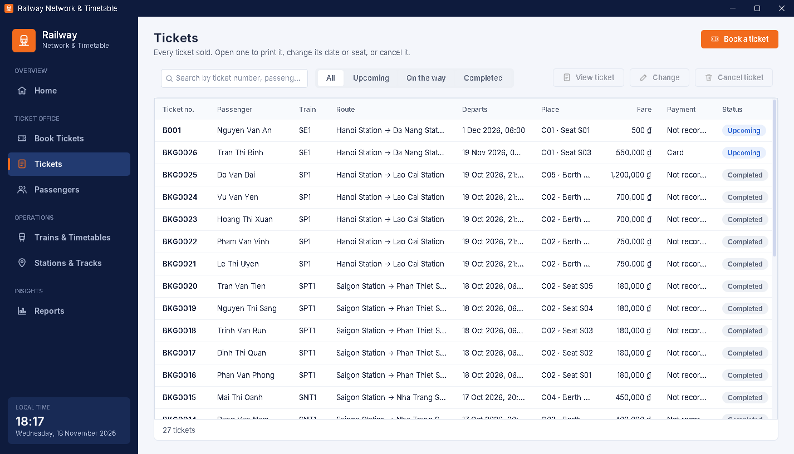
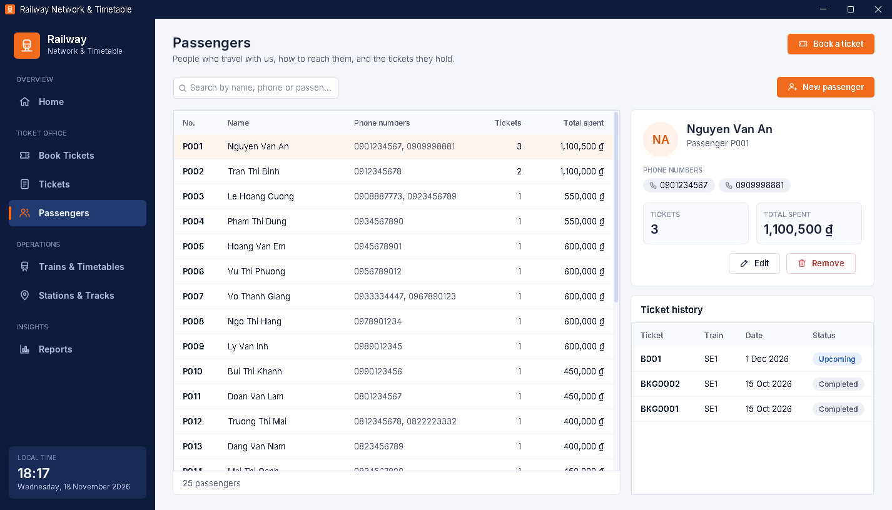
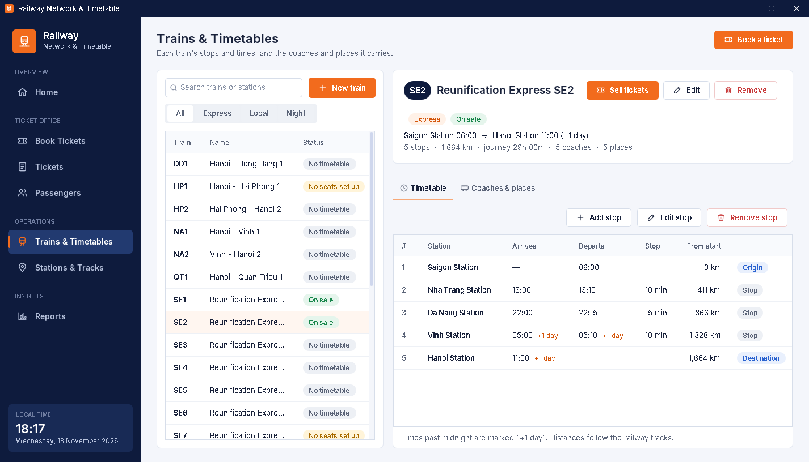
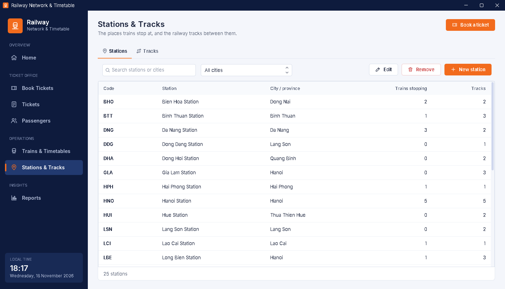
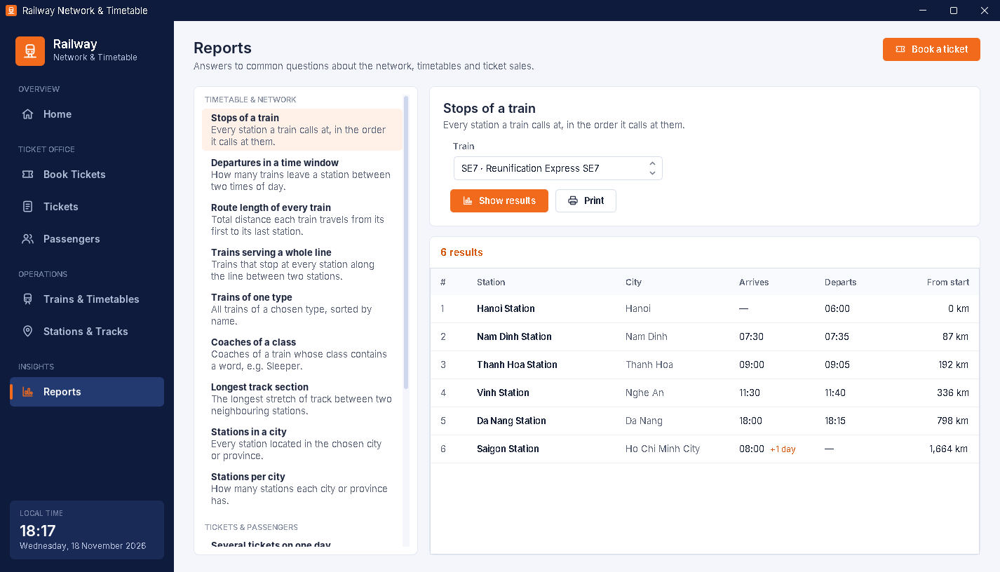

# Railway Network & Timetable

Desktop application for managing a passenger railway network, its timetables and ticket sales.
Course project for **Principles of Database Management (IT079IU), Semester 1 2026–2027**.

- **Java 17+ Swing** (FlatLaf look and feel), built with **Maven**
- **MySQL 8.0**: every business rule lives in stored functions and procedures
- **JDBC only calls routines**: the application never sends SELECT/INSERT/UPDATE/DELETE statements of its own

## Quick start: clone and double-click

```
git clone https://github.com/leonfys/RailwayProject.git
```

Open the folder and double-click **`Setup.exe`** (if it is blocked: `Setup.bat`). Then press
**Set up everything & open the app**. Railway Setup:

1. finds a Java 17+ JDK, or offers to install Temurin 21 with winget;
2. uses the MySQL already on your computer, **or** downloads a private portable MySQL 8.0
   (port 3307, root / root, in `%USERPROFILE%\.railway-mysql`) when you have none or forgot the root password;
3. loads `01` + `02` + `03` from `database/` (skipped if the database is already complete);
4. builds the app with the Maven Wrapper (`mvnw.cmd`, no Maven installation needed);
5. opens the Railway app.

| Page | What it does |
|------|--------------|
| Environment | Checklist (Java, Maven, MySQL, sign-in, database, build), installed vs portable MySQL, user / password of **your** MySQL |
| Database | Reset to sample data, reload routines only (keeps data), run `queries_reference.sql`, delete, create `railway_app` |
| Build & Run | Build, open and close the app; its console output appears live |
| Git | Status, fetch, pull, switch / create branch, commit, merge, push — each button shows the git command it runs |
| Logs | `logs/railway-app.0.log` and `logs/setup-app.log`, filtered by level, followed live |

Every team member's MySQL user and password stay on their own computer: Setup writes them to
`config/setup.properties` (its admin sign-in) and `config/connection.properties` (the app's sign-in), and both files
are ignored by git. The admin account must be allowed to create databases and routines (root is); if it is not,
Setup says so and suggests the portable MySQL. The passwords are stored as plain text in those two files, so use
them only for this local test database.

## Screens

| Screen | What staff can do |
|--------|-------------------|
| Home | Tickets sold, revenue, trains on sale, network size, today's departure board, revenue by train |
| Book Tickets | 4 steps: find a trip → pick a seat on the coach map → passenger & payment → printable ticket |
| Tickets | Search, view and print, change date / seat / fare, cancel |
| Passengers | Add, edit, remove; phone numbers; ticket history |
| Trains & Timetables | Trains, their stops and times (+1 day for overnight), coaches and places |
| Stations & Tracks | Stations and the two-way track sections between them |
| Reports | The 12 required questions in plain language with parameters, plus sales statistics; printable |

## Screenshots

| | |
|---|---|
|  |  |
|  |  |
|  |  |
|  |  |
|  |  |

## Project layout

```
database/
  01_schema_and_seed.sql      the team's SQL.sql, unchanged (CREATE TABLE + sample data)
  02_payment_table.sql        Payment table from the ERD (missing in SQL.sql)
  03_business_routines.sql    all functions and procedures used by the app
  04_app_account.sql          optional EXECUTE-only account for the app
  queries_reference.sql       the team's original queries (reference)
docs/
  DESIGN_DECISIONS.md         conflicts between business rules / ERD / SQL and the chosen options
  original/                   report, normalization, relational algebra, schema image, brief
config/
  connection.properties.example
src/main/java/com/railway/app/
  data/       Database (the only JDBC class), Routine (allowed routine names), Row
  service/    one thin method per routine
  ui/         main window, pages, dialogs, components, theme
tools/setup-app/              source of Railway Setup (Java Swing, own pom.xml)
tools/launcher/               source of Setup.exe (C#), its manifest and icon
scripts/build-setup.ps1       rebuilds SetupApp.jar and Setup.exe (maintainers only)
Setup.exe / Setup.bat         start Railway Setup (SetupApp.jar, prebuilt and committed)
mvnw.cmd, mvnw, .mvn/         Maven Wrapper: downloads Maven 3.9 on first use
setup_database.bat            runs 01 + 02 + 03 with the MySQL client
run.bat                       starts the built application
```

## Manual setup (without Railway Setup)

1. **Database** (MySQL 8.0 server running):
   double-click `setup_database.bat`, or in MySQL Workbench / the `mysql` client run, in order,
   `01_schema_and_seed.sql`, `02_payment_table.sql`, `03_business_routines.sql`.
   `01` starts with `DROP DATABASE`, so it resets all data to the sample data.
2. **Optional, recommended:** edit the password in `04_app_account.sql` and run it. The app account can only
   execute routines; reading a table directly is refused by MySQL.
3. **Connection:** copy `config/connection.properties.example` to `config/connection.properties` and fill in the
   user and password (root, or `railway_app` from step 2). The file is ignored by git.
   If it is missing, the app creates it with default values on first start.
4. **Build and run:**
   ```
   mvnw.cmd package   (or mvn package if Maven is installed)
   run.bat            (or: java -jar target/railway-manager.jar)
   ```
   During development: `mvnw.cmd compile exec:java`.

To change Railway Setup itself, edit `tools/setup-app` or `tools/launcher`, then run
`powershell -ExecutionPolicy Bypass -File scripts\build-setup.ps1` and commit the new `SetupApp.jar` / `Setup.exe`.

If the app cannot connect, it shows a plain message ("We can't reach the booking system right now…").
Technical details are written to `logs/railway-app.0.log`.

## Architecture rule: where the business logic lives

```
Swing screen ──► service method ──► Database.call("{call sp_...(?,?)}") ──► MySQL routine
                                    Database.function("{? = call fn_...(?)}")
```

- Validation, ID generation, status calculation, distances, overnight times, fare suggestion, seat locking and
  transactions are all inside `03_business_routines.sql`.
- A routine rejects bad input with `SIGNAL SQLSTATE '45000'` and a plain-English message, which the app shows as is.
- The Java side only formats values for display (dates, money, "+1 day").

## Mapping of the required queries

| Query (Queries.sql) | Routine | Report in the app |
|---|---|---|
| 1 Stations where SE7 stops, in order | `sp_report_train_stops` | Stops of a train |
| 2 Trains departing Saigon 06:00–12:00 | `sp_report_departures_between` | Departures in a time window |
| 3 Total route distance per train | `sp_report_route_distances` | Route length of every train |
| 4 Trains calling at every station Saigon–Nha Trang (division) | `sp_report_trains_covering_line` | Trains serving a whole line |
| 5 Passengers with two bookings on the same date | `sp_report_passengers_multiple_bookings` | Several tickets on one day |
| 6 Express trains by name | `sp_report_trains_by_type` | Trains of one type |
| 7 Stations in Hanoi | `sp_report_stations_in_city` | Stations in a city |
| 8 Average fare per train type | `sp_report_average_fare_by_type` | Average fare by train type |
| 9 Sleeper coaches of SE3 | `sp_report_coaches_of_class` | Coaches of a class |
| 10 Longest track | `sp_report_longest_track` | Longest track section |
| 11 Passengers with a fare above an amount | `sp_report_passengers_fare_above` | Passengers above a fare |
| 12 Stations per city | `sp_report_stations_per_city` | Stations per city |
| `fn_get_passenger_fare` (team's function) | used as is | Fare paid on a date |

See `docs/DESIGN_DECISIONS.md` for why some results differ from the original queries (for example Query 3).
